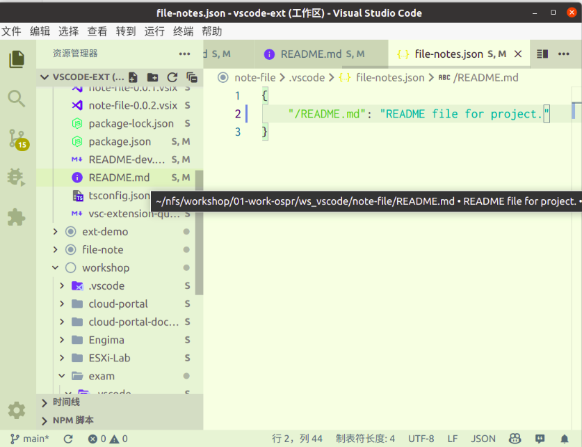

# note-file README

    vscode extension for edit/view file or folder comment

## Features

    edit comment of file or folder
    view comment of file or folder



## Usage

    manually edit comment file: ./vscode/file-notes.json
    right click of file or folder, click 'Set Note ...' sub-menu

## Requirements


## Extension Settings

    Create .vscode/file-notes.json manually.
    Once extension checked the file, it will be activated!

.vscode/file-notes.json example:
```
{
	"/README.md": "README file for project.",
    "/src/main.go": "main file for project.",
    "out": "Build output folder."
}
```

## Known Issues

    vscode workspace first folder's ./vscode/file-notes.json

## Release Notes

Users appreciate release notes as you update your extension.

### 0.0.1

Initial release

### 0.0.3

File watcher - change/delete/create of **/.vscode/file-notes.json

### 0.0.4

Explorer context menu of file or folder , set note


**Enjoy!**
